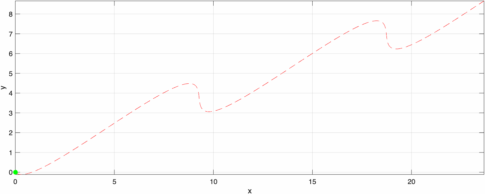
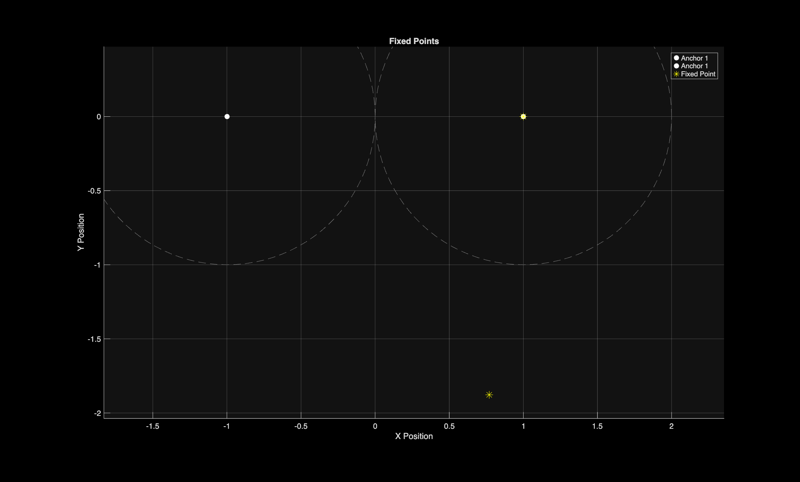
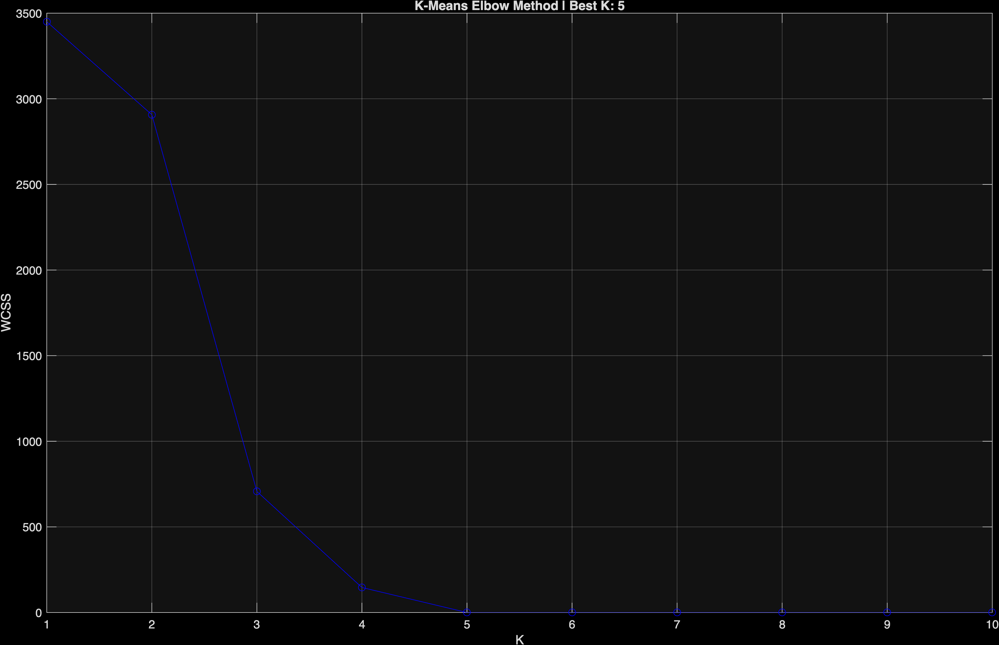
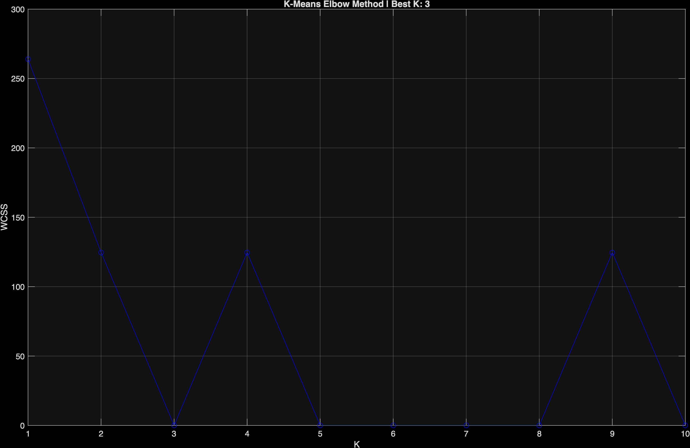
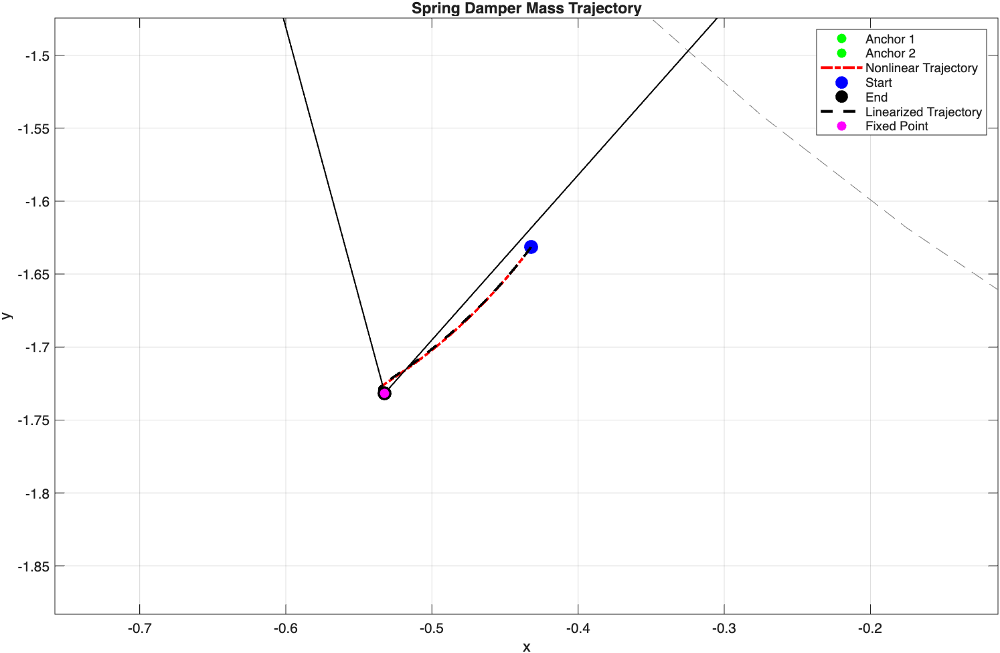
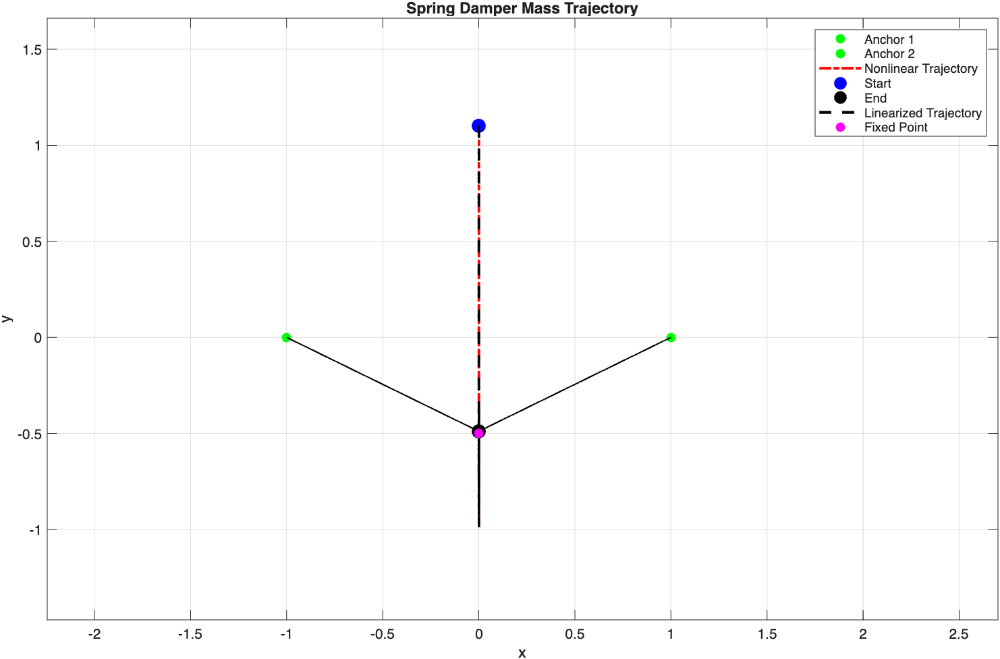

::: {.hidden}
$$
\newcommand{\bup}[1]{\mathbf{#1}}
$$
:::

# P01. ODE — A Particle Problem

## Problem

Set up (define system, draw FBD, write ODEs) a particle problem. Just one particle. 2D or 3D, your choice. Use a force, or forces that you like (gravity, spring, air friction). Any example of interest. Find a numerical solution. Graph it. Animate it. Try to make an interesting observation.

## ODE

Random ODE solved via custom Euler solver.

```matlab
F1 = sin(t) * i_hat + cos(t) * j_hat;
F2 = cos(t) * i_hat + sin(t) * j_hat;

xdot = v;
vdot = F1 + F2;
```

## Trajectory

For the initial conditions of `x,y,vx,vy = z0 = [0, 0, 0.5, -0.5];`


::: {layout-ncol=2}



:::

# P02. Vectors in 3D

*Given four random points $\bup{r}_A, \bup{r}_B, \bup{r}_C, \bup{r}_D$ and a
force $\bup{F}$, write single vector formulas for: 

(a) the minimum distance between lines $AB$ and $CD$

(b) the end points of that shortest segment

(c) the volume of tetrahedron $ABCD$ (derive "⅓ base × height")

(d) the tension in bar $AD$ when $A, B, C$ are fixed and connected by rods to $D$, where $\bup{F}$ is applied.*

# P03. More ODE & Animation Practice

*Pick a simple ODE system (harmonic oscillator, pendulum, Lorenz …) and solve it
three ways: 

(a) a single script with a plain Euler loop

(b) your own Euler solver function calling a RHS function

(c) ODE45. 

(d) study accuracy vs. step size with Euler

(e) vary `RelTol`/`AbsTol` in ODE45 to judge whether MATLAB estimates its own accuracy well.*

# P06. Spring and Mass (2D)

*A mass $m$ on a spring $(k, L_0)$ pinned at the origin, under gravity, starting
from $\bup{r}_0, \bup{v}_0$. \
(a) Find the EoM \
(b) plot and animate the trajectory \
(c) list and carry out as many sanity checks as possible (e.g. $k = 0$ → balistics; $x_0 = v_{x0} = 0$ → stays on the $y$-axis; $g = 0, \bup{v}_0 = 0$ → radial harmonic oscillation; $L_0 = 0$ → …).*

# P07. Simple Animation of a Shape

*Draw an object (face, house, …) and make it move smoothly and interestingly on screen using only rigid motions — translations and rotations, no distortion.*

I defined a rectangle with 4 points and applied these transformations: \
1. translate by $\vec{T} = (2 2)^T$ 
2. rotate by $45^\circ$ using rotation matrix. 

Once we have initial and final coordinates of the shape, I linearly interpolate
them from time 0 to some time tf within which the animation occurs.

{width=70%}


# P08. Simplest Dynamics in Polar Coordinates

*A force-free particle on a plane, posed in polar coordinates: 

(a) write $\bup{a} = \bup{0}$ as ODEs in $(r, \theta)$
(b) solve numerically for various ICs
(c) check the path is a straight line at constant speed
(d) define a quantitative "straightness" measure and evaluate it
(e) does it improve as tolerances are tightened?*

The equations of motion for this problem come out to be:

$\ddot{r} = r \dot{\theta}^2$

$\ddot{\theta} = -2\frac{r \dot{r}\dot{\theta}}{r}$

Numerical solution at 
```matlab
r0        = 1;
theta0    = 10 * pi/180;
rdot0     = 1;
thetadot0 = 1;
```


For the straightness check we compare the solution with the solution $\vec{r}(t)= vec{r}(0) + vec{v}t$


# P09. Cannon Ball (Linear Drag)

*A cannon ball launched at angle $\theta$ and speed $v_0$ with gravity and linear viscous drag $|cv|$. (a) Analytical $x(t), y(t)$; (b) numerical solution for $\theta = \pi/4$, $v_0 = g = m = c = 1$; (c) compare — error at $t = 2$ vs. tolerances; (d) trajectories as $v_0 \to \infty$ — what shape?; (e) where does the range-maximising angle $\theta^*$ tend as $v_0 \to \infty$?*

# P11. Central Force

*Only force is central, $\bup{F} = -F(r)\,\hat{\bup{e}}_r$. (a) Find $F(r)$ such that, across circular orbits, the speed is independent of radius. (b) Numerically (with `fsolve` over ICs and period) find a periodic orbit that is neither circular nor straight, for a force law other than a linear spring or inverse-square gravity; comment on chaotic-looking failed searches and on the minimum number of loops for power laws.*

{width=50%}

## Periodic Solutions

### For $F(r) = 1$

Found using fsolve root finding
with initial conditions -    [ 4.837094489229557 0.113739688509354 0.481812323218859 1.333913034846417 ]
time period =   49.578757824567518

Using jacobian analysis, we find this is an unstable periodic motion.
eigvals of jacobian = [   0.786327175145648 0.786327175145648 1.187326408237210 0.842228377131789]

{width=80%}

# P12. Canon Ball 2 (Quadratic Drag)

*A cannon ball m is launched at angle $\theta$ and speed $v_0$. It is acted on
by gravity g and a quadratic drag with magnitude $|cv^2|$.

(a) Find a numerical solution using θ= π/4, v0 = 1 m/s, g= 1 m/s2, m= 1 kg.

(b) Numerically calculate (by integrating W= P along with the state variables)
the work done by the drag force. Compare this with the change of the total
energy. Make a plot showing that the difference between the two goes to zero as the integration gets more and more accurate.*

# P13. Statics vs Dynamics — Two Spring Damper System

*A 2D point mass under gravity, connected to anchors $A$ and $B$ by springs $(k_A, L_A), (k_B, L_B)$ with parallel dashpots $(c_A, c_B)$ and air drag $c_d$. (a) Find an equilibrium; (b) simulate the motion; (c) find **all** equilibria and the most/least number possible as parameters vary; (d) determine stability both by simulation near the equilibrium and by eigenvalues of the linearised system.*

## Intro

System animation, fixed point analysis and clustering, and linear stability analysis for the **Two Spring and Two Damper System** with drag.

## Problem and Dynamics:

{width=70%}

## Fixed Points

The fixed points were found using `fsolve`, and clustering of fixed points was performed by using the following algorithms:

1. KMeans: within cluster sum of squares was found was varying K and the best K was determined by the elbow method.
2. DBScan: the distance parameter was kept very small (0.005) which converged correctly for every scenario I tried (except the infinite fixed point cases).

### Fixed Points = 2

::: {layout="[35,65]" layout-valign="center"}
```matlab
% System Constants
p.m = 1;
p.g = 10;

p.b1 = 1;
p.b2 = 1;

p.d = 0.6; % drag coef

p.k1 = 1;
p.k2 = 10;
p.l1_0 = 1;
p.l2_0 = 1;

p.r1 = [-1; 0];
p.r2 = [1; 0];
```


:::

Both KMeans and DBScan provided the right answer for this.

### Fixed Points = 5

::: {layout="[35,65]" layout-valign="center"}
```matlab
% System Constants
p.m = 1;
p.g = 0;

p.b1 = 1;
p.b2 = 1;

p.d = 1; % drag coef

p.k1 = 10;
p.k2 = 10;
p.l1_0 = 1.5;
p.l2_0 = 1.5;

p.r1 = [-1; 0];
p.r2 = [1; 0];
```


:::

::: {layout-ncol=2}



:::

### Fixed Points = 1

::: {layout="[35,65]" layout-valign="center"}
```matlab
% System Constants
p.m = 1;
p.g = 10;

p.b1 = 1;
p.b2 = 1;;

p.d = 1; % drag coef

p.k1 = 10;
p.k2 = 10;
p.l1_0 = 1;
p.l2_0 = 1;

p.r1 = [-1; 0];
p.r2 = [1; 0];
```


:::

Both KMeans and DBScan provided the right answer for this.

### Fixed Points = 4, Two of them are very close

::: {layout="[35,65]" layout-valign="center"}
```matlab
% System Constants
p.m = 1;
p.g = 0;

p.b1 = 1;
p.b2 = 1;;

p.d = 1; % drag coef

p.k1 = 10;
p.k2 = 10;
p.l1_0 = 1;
p.l2_0 = 1;

p.r1 = [-1; 0];
p.r2 = [1; 0];
```


:::

{width=50%}

::: {layout-ncol=2}



:::

### Fixed Points = 3

::: {layout="[35,65]" layout-valign="center"}
```matlab
% System Constants
p.m = 1;
p.g = 1;

p.b1 = 1;
p.b2 = 1;

p.d = 1; % drag coef

p.k1 = 1;
p.k2 = 1;
p.l1_0 = 1;
p.l2_0 = 2;

p.r1 = [-1; 0];
p.r2 = [1; 0];
```


:::

DBScan was correct all the times, KMeans sometimes said best K was 2, while other times said it was 3.

### Fixed Points = Infinite

When gravity is off, and either of the spring constants are zero, all points on the free length circle of the active spring are valid unique fixed points.

{width=50%}

Also when gravity is off, and both the springs are active, but the anchor positions are the same, we get infinite fixed points.

{width=50%}

## Linearised Motion

**Task:**

- Using the Jacobian supplied by fsolve at one of the stable fixed points, solve the linearized equations for motion for an initial condition near the fixed point.
- Using the same initial condition, use ODE45 to find the motion.
- Repeat for an unstable fixed point

**System Used:**
The same parameters that resulted in 3 fixed points were used.

Stable Fixed Points:

- [-1; 0]
- [-0.5323; -1.7316]

Unstable Fixed Points:

- [1.2412; 0.2169]

### Response near stable fixed point

{width=60%}

### Response near unstable fixed point

{width=60%}

### Response When L0 = 0, b = 0

::: {layout-ncol=2}



:::

# P14. What Means "Rate of Change of Angular Momentum"?

*For a moving particle $P$ and a moving reference point $C$, decide for which definition of $\bup{H}_{/C}$ the equation $\bup{M}_C = \dot{\bup{H}}_{/C}$ holds (i.e. is consistent with $\bup{F} = m\bup{a}$): (a) $\bup{r}_{P/C'} \times \bup{v}_{P/0}\, m$ with $C'$ fixed and instantaneously coincident with $C$; (b) $\bup{r}_{P/C} \times \bup{v}_{P/0}\, m$; (c) $\bup{r}_{P/C} \times \bup{v}_{P/C}\, m$ — in general, or only in special cases?*

<embed src="14_AngularMomentum/P14_AngularMomentum.pdf" type="application/pdf" width="100%" height="900px">

# P15. Potential Energy

*Find the potential-energy function for a set of 3D force fields: constant force, zero-rest-length spring, spring with rest length, inverse-square central force, general central force $f(r)$, spring and inverse-square attraction between two points, constant force along $\hat{\boldsymbol{\lambda}}$, and an $x$-only force $f(x)$ — verifying the given answers with multivariable calculus.*

<embed src="15_PotentialFunction/P15_PotentialFunction.pdf" type="application/pdf" width="100%" height="900px">
